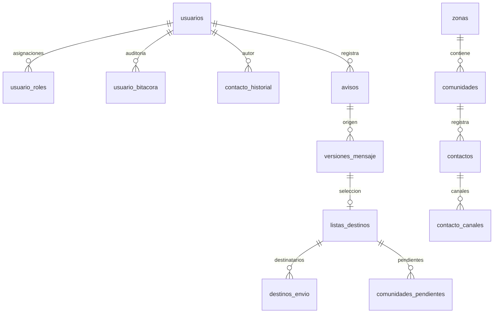

# Modelo relacional SQL Server

Claves principales GUID en entidades. Claves compuestas en asignaciones de rol, destinos (lista, canal y dirección) y comunidades pendientes. Los canales de contacto usan identidad entera.

No se elimina una zona con comunidades. Eliminar una comunidad elimina sus contactos y canales; el historial de contactos conserva identificadores y snapshots, deliberadamente sin FK al contacto eliminado. Las relaciones con autores y las referencias entre versiones restringen borrados. Cada versión tiene como máximo una lista guardada.

Las versiones referencian aviso, cadena y versiones anterior, reemplazada y relacionada. El traslado verifica esas relaciones antes de confirmar la transacción. En SQL Server las geometrías se almacenan como `geometry` y las instantáneas JSON como `nvarchar(max)` con `ISJSON`.

La migración SQL Server incluida es la fuente de verdad del esquema; no se ejecutan las migraciones históricas PostgreSQL contra SQL Server.
